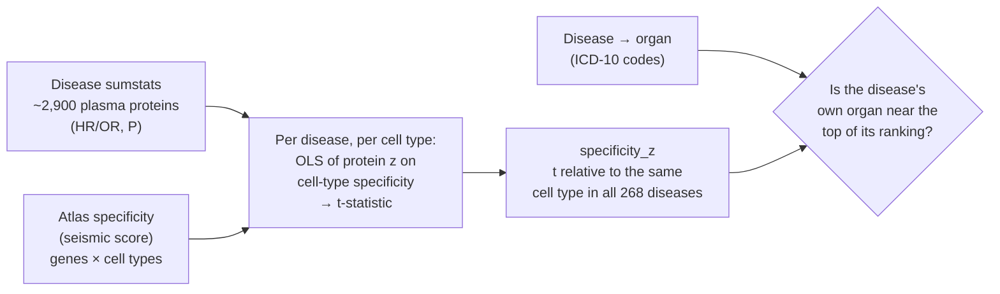
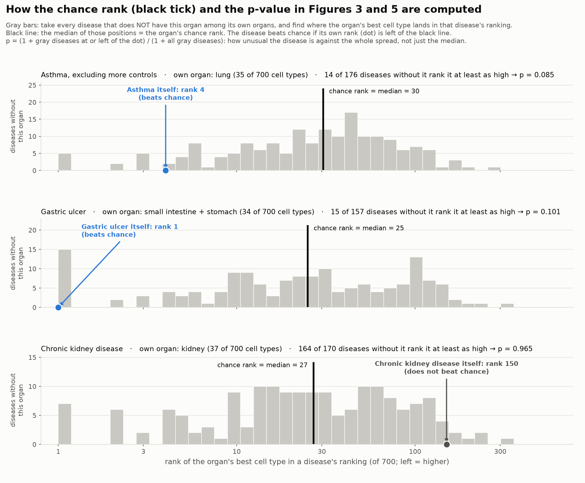
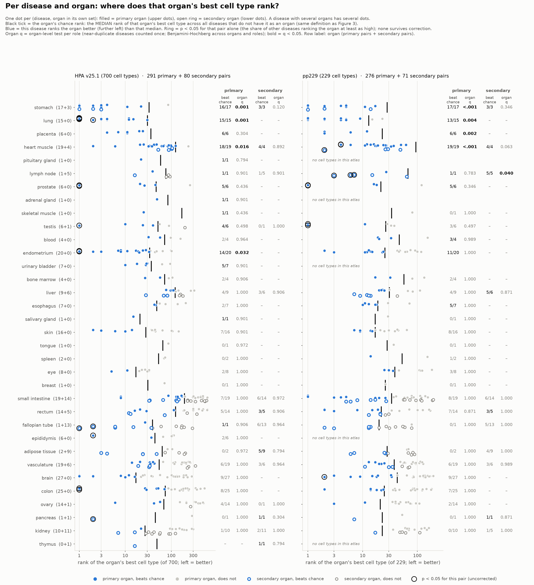
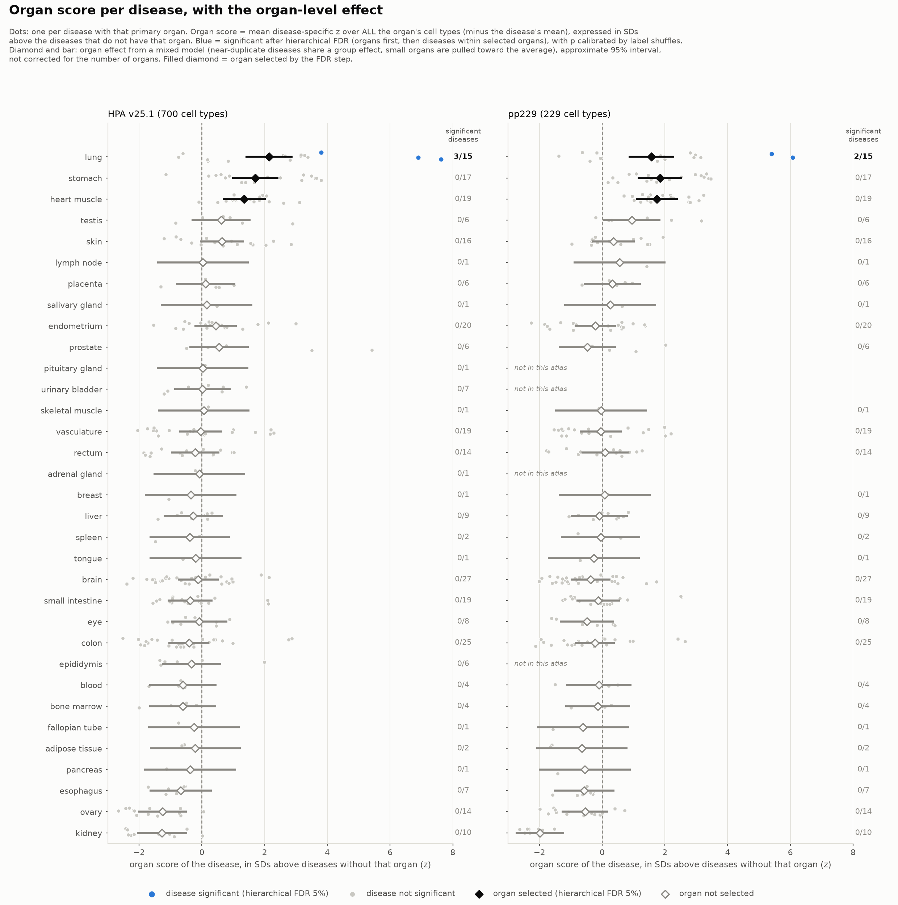
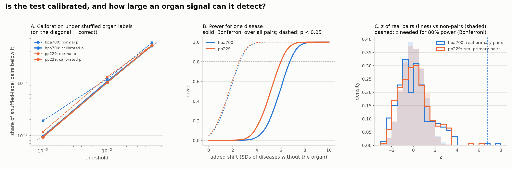

# Do the cell-type results point to the disease's own organ?

**Short answer.** Reported per disease and per organ; no claim is made about "all diseases".
* **Organs:** **lung, stomach and heart** diseases have clearly higher scores for their own organ than diseases without
  it, in both atlases. Effect 1.3–2.1 SD, all 95% intervals above 0, each selected at 5% FDR. **Kidney** diseases score
  their own organ clearly *lower* (−1.3 and −2.0 SD). Most other organs show nothing either way.
* **Single diseases:** after hierarchical FDR, **interstitial lung disease and idiopathic pulmonary fibrosis** (both
  atlases) and influenza/pneumonia (hpa700) are significant on their own. Stomach diseases (ulcers, gastritis) just
  miss, and cardiomyopathy and conduction disorders come close in pp229.
* **What the test can see:** it is calibrated under shuffled labels. For one disease to pass on its own, its organ's
  score has to sit about 6 SD above diseases without that organ, and only the lung-fibrosis diseases reach that. Most
  real effects are 1–4 SD, which the test detects for groups of diseases (organs) but not for single diseases.

Atlases: HPA v25.1 (`hpa700`, 700 cell types) and `pp229` (229 cell types). Diseases: UK Biobank
Proteome-Phenome Atlas, prevalent cases (268 diseases, of which 191 / 184 have a primary organ present in the
atlas and are evaluated).

---

## 1. Methods



### 1a. Which organ does each disease belong to? (`fetch_finngen_icd10.py`, `build_disease_organ_map.py`)
The organ assignment is made from disease definitions only. It uses no expression data and no results from
the cell-type analysis, so it cannot be circular.

1. **Disease → ICD-10 codes.** Each Atlas disease is a FinnGen endpoint (e.g. `K11_ALCOLIV`). Its ICD-10
   codes come from the endpoint's definition on [Risteys](https://risteys.finngen.fi), with included endpoints
   resolved recursively. The endpoint name on Risteys matched the Atlas disease name in every case found, which
   confirms the codes belong to the right disease. Two endpoints that are not on Risteys were assigned by hand
   (`manual_overrides.tsv`, with the reason).
2. **ICD-10 category → organs.** Each 3-character category (e.g. K25) is mapped to atlas organs through the
   narrowest matching block in a hand-written table (`icd10_block_to_organs.tsv`: K25–K28 peptic ulcer →
   stomach, small intestine). The table was written from ICD-10 knowledge; edit it to change what a code means.
3. **Aggregate to the disease.** `organ_support(o)` = the share of the disease's organ-bearing categories that
   point to organ *o*. Symptom, injury and external-cause codes (R, S, T, V–Z) are ignored. Organs with support
   ≥ 0.25 are **primary**; all others the table lists are **secondary**. The 0.25 floor stops one stray
   cross-chapter code from defining a disease. A disease can have several primary organs (gastric ulcer:
   stomach and small intestine).
4. **Status.** Of 268 diseases, **191 are *scorable*** (≥1 primary organ present in the atlas). 18 have only
   secondary organs. **59 are not scorable**: the organ is not in either atlas (joints, bone, thyroid, ear,
   peripheral nerve, abdominal wall) or the disease is not organ-based (sepsis, injury).
5. **Confidence.** Of the 191 scorable diseases, **160 high**: the Atlas chapter and the ICD-10 block table
   agree on the organ system. **28 medium**: the chapter cannot corroborate the organ (infections, neoplasms and
   endocrine/metabolic diseases span many organs; five diseases filed under "Endocrine" are really mental
   disorders such as depression), so the organ rests on the block table alone. **3 review**: two manual
   assignments (skin squamous cell carcinoma, death due to cardiac causes) and gout, where the ICD-10 block table
   and the Atlas chapter disagree.

**Independent cross-check.** The block table is compared with MONDO (disease → `disease_has_location`) rolled up
through UBERON anatomy to atlas organs (`mondo_crosscheck.py`). MONDO records a location for only ~8% of
terms, so this checks a subset. In that subset the two sources **agree for 64 diseases and disagree for none**
(61 share a primary organ, 3 share a secondary organ). 68 diseases have a MONDO match without a location and 136
have no match, so for ~76% of diseases the check is silent.

**Known weak spots.** Lipid disorders → liver (medium confidence), gout → kidney (review: its definition
includes renal codes, N16), and pregnancy/labour → endometrium/placenta. The last is not a weak assignment in the
results (placenta 6/6 beating chance in both atlases, the strongest block in the clustermaps), but the pregnancy
diseases are so distinctive that this says little about how accurate the mapping is elsewhere.

`organ_review_sheet.csv` lists every assignment with its flags and MONDO result, with empty columns for a domain
expert to correct. **No such expert review has been done yet**, so the table is not clinically validated.


The figure shows 50 representative diseases with the organs assigned and the ICD-10 categories they came from.
They are chosen by rule, not by hand: near-duplicate diseases (same primary organs, ICD-10 category sets with
Jaccard overlap ≥ 0.5) are merged into 158 groups; each group is shown by its most typical member (`×n` = how
many diseases it stands for). Groups are picked so that every primary organ appears at least once, then by new
organ combinations, then by size. The 50 rows stand for 83 of the 191 diseases. The full table is
`disease_organ_map.tsv`. Reproduce with `python organ_mapping/plot_disease_organ_examples.py`.

### 1b. How each cell type is scored for a disease (`univar_association_testing.py`)
For one disease and one cell type *c*, across all measured proteins:

    z_protein  ~  specificity_c(protein's gene)  +  pleiotropy(protein)

* `z_protein`: signed z of the protein–disease association. |z| comes from the P-value; the sign is
  + when HR/OR > 1.
* `specificity_c`: the atlas's seismic specificity score of the gene for cell type *c*.
* `pleiotropy`: the protein's mean signed z across diseases in **other** ICD-10 chapters. It absorbs
  proteins that go up in almost every disease (GDF15 and others).
* The *t*-statistic of the specificity slope is the cell type's association with the disease.
  Significance comes from 2,000 Freedman–Lane permutations stratified by pleiotropy decile, with max-T
  family-wise control across cell types (`pval_maxT_one_side`).

### 1c. Removing each cell type's baseline (`cross_disease_summary.py`)
Some cell types (mostly macrophages and monocytes) score high for nearly every disease. Each t is therefore
re-expressed relative to the same cell type across all 268 diseases:

    specificity_z(d, c) = ( t(d, c) − median over diseases of t(·, c) ) / ( 1.4826 × MAD )

**All organ evaluations below rank cell types by `specificity_z`.** A cell type is *disease-specific* when
it is significant (max-T p ≤ 0.05) *and* its specificity_z has FDR ≤ 0.05.

### 1d. Which organ does each cell type belong to?
The organ of the tissue it was sampled from (`organ_vocabulary.tsv`). This includes the tissue's immune,
endothelial and stromal cells: a "kidney macrophage" counts as kidney.

### 1e. Best-rank view (descriptive): chance rank and pair p
Every evaluation is per (disease, organ) pair. The organ can be one of the disease's primary organs or one of its
secondary organs (`evaluate_organ_hits.py`).

* **Best rank:** the rank of the organ's best cell type in the disease's ranking (1 = top).
* **Comparison diseases:** every disease that does *not* have that organ among its primary or secondary organs.
  Related diseases (for heart: heart failure, atrial fibrillation, cardiomyopathy …) are therefore never compared
  with each other; a heart disease is compared with non-heart diseases.
* **Chance rank** (black tick in Figures 3 and 5): the median best rank of the organ across the comparison diseases.
  A disease *beats chance* if its best rank is smaller.
* **Pair p-value:** (1 + number of comparison diseases ranking the organ at least as high) / (1 + number of
  comparison diseases). It uses the whole spread behind the tick, not just its median, so an organ that ranks high
  for every disease (generic signal) is automatically harder to pass. Ties count against the disease.
  **q-value:** Benjamini–Hochberg across all pairs of the atlas (primary and secondary together).
* **Organ-level test (exploratory):** for one organ and role (primary or secondary), the mean pair p of its diseases,
  with near-duplicate diseases (same primary organs, ICD-10 overlap ≥ 0.5) averaged into one value. This is compared with
  the same mean for the same number of near-duplicate groups drawn at random from the comparison diseases
  (20,000 draws). Benjamini–Hochberg across organs × roles.

### 1f. Formal test: organ score, hierarchical FDR and mixed model (`organ_hierarchical_test.py`)
The best rank (1e) is intuitive but uses one cell type per organ and cannot give small p-values. The formal test uses
every cell type of the organ:

1. **Organ score** S(d, o) = mean specificity_z over all of organ *o*'s cell types in disease *d*, minus *d*'s mean over all
   cell types (removes disease-wide shifts).
2. **Pair z** = (S(d, o) − mean) / SD over the comparison diseases (the same set as for the chance rank: diseases without *o*
   as a primary or secondary organ). Normal p-values are slightly optimistic in the far tail, so they are **calibrated by
   label shuffles**: organ assignments are permuted across diseases 250 times, and p_cal is the share of shuffled-label
   p-values at or below the observed one. Another 250 shuffles are held out to check the calibration (Figure 7A).
3. **Hierarchical FDR** (Benjamini & Bogomolov 2014), matching how results are reported. First, organs are selected by
   BH at 5% on an organ-level p-value: the mixed-model p (step 4) for primary organs, and Simes for secondary organs, which
   are too small for the model. Second, inside the R selected organs out of m, diseases are tested by BH at 5% × R / m.
4. **Mixed model** on the primary pairs' z: `z ~ 1 + (1 | organ) + (1 | near-duplicate group within organ)` (REML,
   statsmodels; R/lme4 was not available). Near-duplicate diseases share a group effect, so five asthma definitions count
   roughly once, and organs with few diseases are pulled toward the average. The organ effect is the intercept plus the
   organ's random effect, with an approximate 95% interval.
5. **Calibration and power** (Figure 7): calibration is checked under held-out label shuffles. For power, a known shift is
   added to the score of disease–organ pairs that are not real pairs, and the share then detected is recorded.

---

## 2. Results

### What a hit looks like


Gastric ulcer is a clean hit: chief and parietal cells rank first and second. Asthma finds lung epithelium
(ranks 4, 5 and 7) among bone-marrow myeloid cells. Heart failure is led by smooth muscle and pericytes from
many tissues, which is a lineage signal, not an organ signal. Chronic kidney disease has no kidney cell type
in its top 15.

### How the chance rank and the p-value are computed


Gray bars are the comparison diseases. The black line (their median) is the chance rank; the disease's p is the share
of gray bars at or left of its dot.

### Per disease, single-organ diseases


Read row by row. Rings mark the pairs with p < 0.05; none survive correction. Organ q (right column) is the
organ-level test on the diseases shown in that row:

| organ (single-organ diseases) | hpa700: beat chance, organ q | pp229: beat chance, organ q |
|---|---|---|
| stomach | 4/4, **0.012** | 4/4, **0.003** |
| lung | 11/11, **< 0.001** | 10/11, **< 0.001** |
| heart muscle | 7/7, **0.012** | 7/7, **< 0.001** |
| urinary bladder | 5/6, 0.67 | not in atlas |
| liver, skin, esophagus, vasculature, eye, brain | about half or fewer, q ≥ 0.75 | same |
| kidney | 0/9, 1.0 | 0/9, 1.0 |

### Per disease and organ, primary and secondary


Every organ in a disease's own set gets a dot, so diseases with several organs appear in several rows. With all
primary pairs, the organ-level test passes (q < 0.05) for stomach, lung and heart in both atlases, endometrium in hpa700
(14/20, q = 0.032) and placenta in pp229 (6/6, q = 0.002; 6/6 but q = 0.30 in hpa700). Among secondary organs only
lymph node in pp229 passes (5/5, q = 0.040: varicose veins, DVT and phlebitis), and not in hpa700 (1/5). The
earlier lead of the liver as a secondary organ of the alcohol and substance-use diseases (pp229 5/6 beat chance) is
one near-duplicate group and does not pass (q = 0.87).

This organ q is the simple best-rank test. Only stomach, lung and heart are also selected by the stricter formal test
below, so treat endometrium, placenta and lymph node as leads.

### Formal test: organ score per disease, with the organ-level effect


The organ score already does far better than the best rank. 45 of 371 pairs (hpa700) and 42 of 347 (pp229) have
p_cal < 0.05, against 19 and 17 expected by chance.

| organ | hpa700: effect (95% interval), selected? | pp229: effect (95% interval), selected? |
|---|---|---|
| lung | **2.14 (1.39, 2.90)**, yes | **1.57 (0.84, 2.30)**, yes |
| stomach | **1.70 (0.97, 2.44)**, yes | **1.85 (1.14, 2.56)**, yes |
| heart muscle | **1.35 (0.66, 2.04)**, yes | **1.74 (1.08, 2.41)**, yes |
| testis | 0.61 (−0.33, 1.56), no | 0.94 (0.03, 1.85), no (FDR q = 0.22) |
| ovary | −1.25 (−2.03, −0.48) | −0.55 (−1.30, 0.20) |
| kidney | **−1.27 (−2.08, −0.47)** | **−1.98 (−2.76, −1.21)** |

Effects are in SDs of the organ score among diseases without that organ. Intervals are not corrected for the ~30 organs;
"selected" is the FDR-corrected statement.

**Single diseases significant after hierarchical FDR:**

| disease | organ | hpa700: z, p_cal | pp229: z, p_cal |
|---|---|---|---|
| Interstitial lung disease | lung | 7.6, < 0.0001 | 6.1, < 0.0001 |
| Idiopathic pulmonary fibrosis | lung | 6.9, < 0.0001 | 5.4, < 0.0001 |
| Influenza and pneumonia | lung | 3.8, 0.0006 | not significant |

The two fibrosis diseases are one near-duplicate group, so this is one independent finding plus pneumonia. Stomach
diseases just miss: gastroduodenal ulcer, gastritis and "oesophagus, stomach and duodenum" have within-organ q ≈ 0.0037,
against thresholds of 0.0032 (hpa700) and 0.0038 (pp229). Heart diseases are next in pp229 (cardiomyopathy, conduction
disorders, q ≈ 0.012).

### Is the test calibrated, and what can it detect?


* **Calibration (A).** On held-out label shuffles, the calibrated p-values fall below 0.05, 0.01 and 0.001 in 5.1%, 1.0%
  and 0.09% of pairs, as they should. The uncalibrated normal p was up to 2× too optimistic at 0.001. Under shuffled labels,
  hierarchical FDR made a discovery in 0% (hpa700) and 2% (pp229) of shuffles. Organ intervals excluded 0 for 0.3% and 5.2%
  of organs.
* **Power (B, C).** A single disease needs its organ score about **6 SD** above diseases without that organ for 80% power
  after correcting for all pairs; p < 0.05 alone needs about 2.6 SD. Real primary pairs are mostly between −2 and 4 SD, and
  only the lung-fibrosis diseases exceed 6. In units of the original scores, a disease's organ would need its cell types to
  rise on average by about 2.1 (lung), 2.8–3.9 (stomach) or 4.7–4.9 (heart) disease-specific z above their usual level.
  **A non-significant single disease is therefore weak evidence of no organ signal.** Organ-level effects of 1–2 SD are
  detected because several diseases are pooled.

### Best-rank view (descriptive)
Figures 3 and 5 use the best-ranked cell type of each organ. They are easier to read, but less powerful. They are kept as
the intuitive view, and the formal statements above come from Figures 6 and 7.

### Why the best-rank test cannot make single diseases significant
Two reasons, both visible in Figure 3b:
1. **Resolution.** With ~170 comparison diseases the smallest p is ~0.006. Benjamini–Hochberg over ~350 pairs would need
   p ≈ 0.0001 for the best pair, or dozens of pairs tied at the minimum.
2. **Some unrelated diseases rank the organ near the top as well.** In hpa700, 12 of 176 non-lung diseases rank a
   lung cell type in the top 3 (depression, schizophrenia, labour, nail disorders …), so even rank 1 gives p ≈ 0.03.
   In pp229, 23 of 161 non-heart diseases rank heart above the heart diseases' median (kidney failure, cataract,
   labour …). Only 1–2 of these have the organ in their ICD-10 chapter's organ list. They are not related heart or lung
   diseases (those are excluded) but leftover shared signal (see limitations).

A single disease can be significant only if hardly any unrelated disease ranks its organ as high. The organ-level
test is the way to ask whether a group of related diseases does better than unrelated ones together.

---

## 3. How to report organ concordance
1. **Per organ, then per disease.** Show Figure 5 for the picture. Take the statements of significance from the organ
   effects (Figure 6) and the hierarchical-FDR result, then name the significant diseases. Do not quote a pooled AUC or a
   pooled share of diseases.
2. **Keep the denominator and the power.** Report how many pairs pass next to how many chance gives, and say that single
   diseases need about 6 SD to be detectable.
3. **Defensible claims:** lung, stomach and heart concordance (both atlases), lung fibrosis as single diseases, and kidney
   discordance. Testis (pp229) is a lead only.
4. **Count near-duplicate diseases once** (done in the model).

## 4. Limitations
* Organ labels come from ICD-10 and are only partly validated (MONDO has locations for ~8% of terms). A disease
  that truly involves an organ but is not labelled with it sits among the comparison diseases and makes the test
  stricter (e.g. kidney failure ranking heart #1 may be real cardio-renal biology).
* Diseases are not independent. Related endpoints (e.g. four duodenal and gastric ulcer definitions) share
  most cases; the organ-level test averages near-duplicates, but the grouping rule is approximate.
* The organ-level results for stomach, lung and heart were first noticed in these same data (best-rank view). The formal
  test was designed afterwards, so it is not an independent confirmation; a held-out cohort or platform is needed.
* The mixed model's intervals are approximate (intercept variance + conditional variance of the organ effect), and the
  model was fitted with statsmodels instead of lme4. Calibration under label shuffles (Figure 7A) is the check that
  matters, and it holds.
* Power was simulated by shifting the organ score directly, not by injecting signal into protein-level data, so it
  describes the test's last step, not the whole pipeline.
* The reference labels (ICD-10 → organ) have not been checked against an independent source such as genetics-based tissue
  enrichment (LDSC-SEG / MAGMA).
* A shared signal across diseases remains even after the pleiotropy covariate: the first principal component
  of the protein × disease z-matrix explains 40% of the variance. Removing more of it, and scoring tissue
  *within* lineage, are the next methodological steps.

## Reproduce
```bash
python organ_mapping/evaluate_organ_hits.py                 # Figures 1, 3, 5 (best-rank view)
python organ_mapping/organ_hierarchical_test.py             # Figures 6, 7 (formal test); needs statsmodels
python organ_mapping/plot_chance_explainer.py               # Figure 3b
python organ_mapping/plot_disease_organ_examples.py         # primary-organ example figure
python organ_mapping/plot_organ_heatmaps.py --atlas both    # clustermaps
```
Tables in `figures/evaluation/`: `<atlas>_disease_organ_pairs.tsv` (one row per disease–organ pair: best rank, best cell
type, chance rank, p, q, near-duplicate group), `<atlas>_organ_level_test.tsv` (best-rank organ test),
`<atlas>_organ_scores.tsv` (formal test, one row per pair: organ score, z, p_cal, hierarchical-FDR result, model effect),
`<atlas>_organ_effects.tsv` (mixed-model organ effects, FDR selection, shift needed for 80% power) and `calibration.tsv`.
