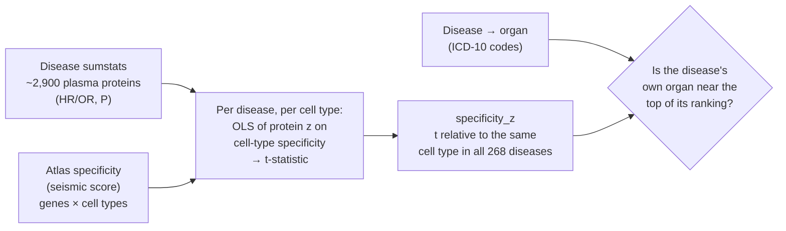
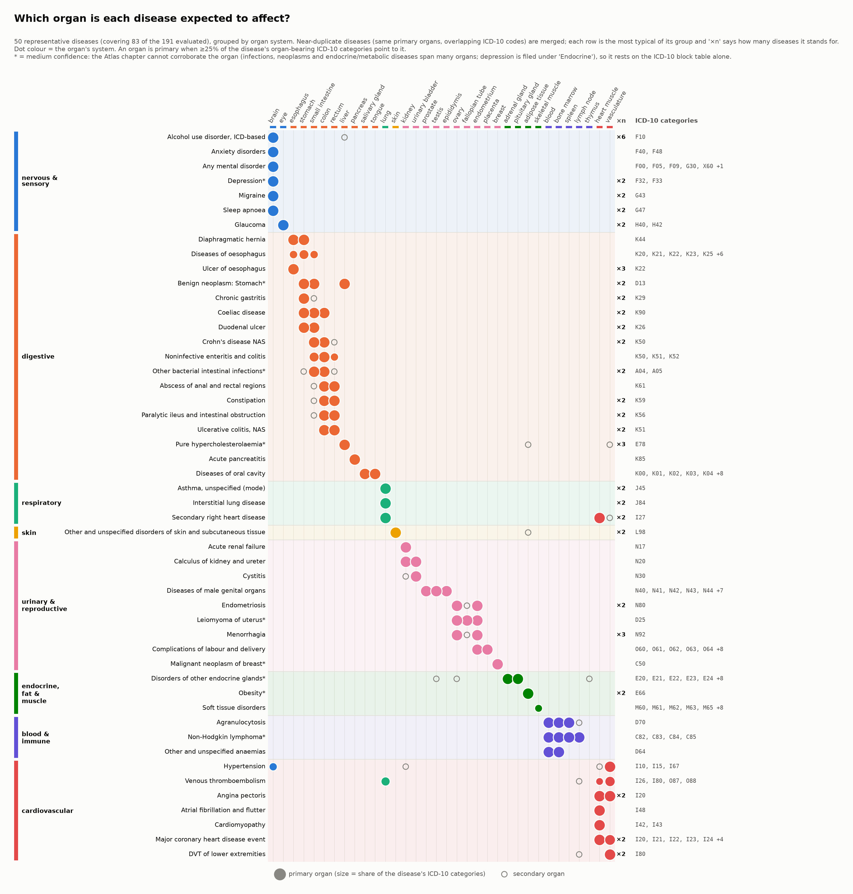
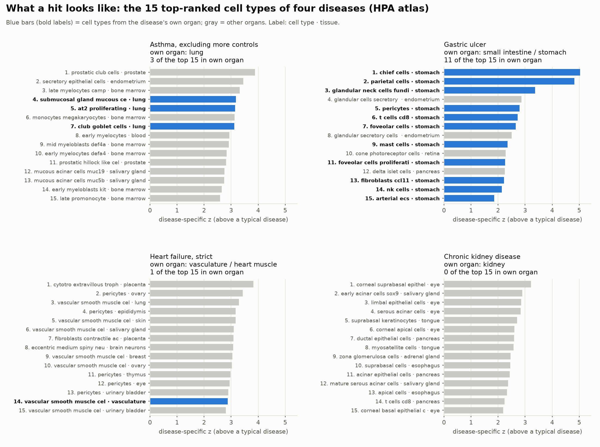
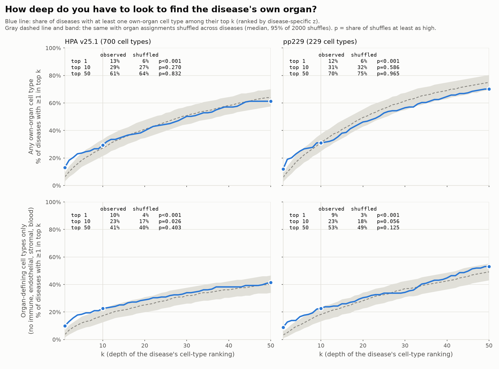
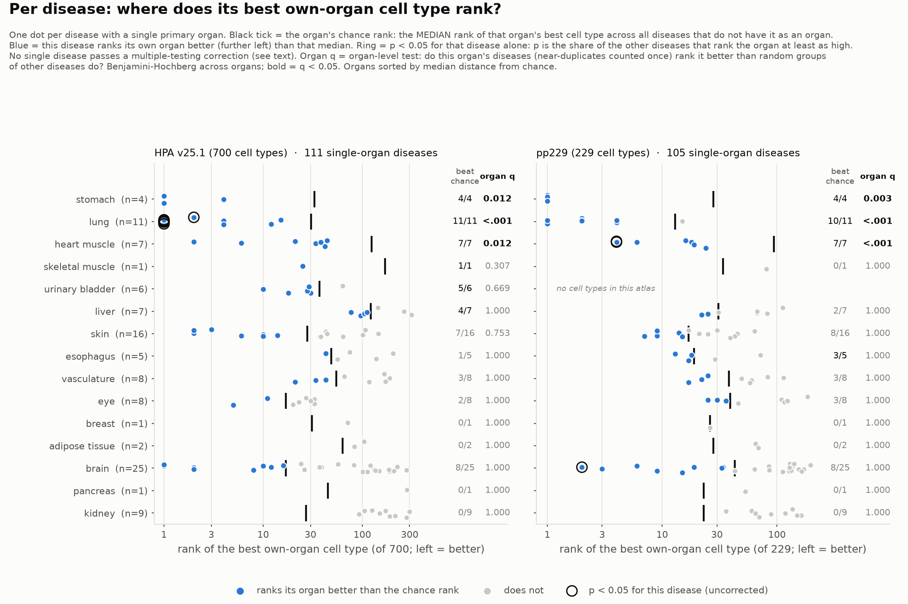

# Do the cell-type results point to the disease's own organ?

**Short answer.** Sometimes, and only at the very top of the ranking. For about 1 in 8 diseases, the
top-ranked cell type is in the disease's own organ. That is twice what chance gives (p < 0.001, both atlases).
The signal is concentrated in **stomach, lung and heart**, where the own organ beats chance in every
disease, and it is absent for **kidney** (0 of 9 diseases), adipose and pancreas. Below the top 5 the
rankings no longer follow the organ. The cell types the pipeline calls *disease-specific* are 3–4× enriched
for the disease's own organ, but only 25–41 diseases have any.

Atlases: HPA v25.1 (`hpa700`, 700 cell types) and `pp229` (229 cell types). Diseases: UK Biobank
Proteome-Phenome Atlas, prevalent cases (268 diseases, of which 191 / 184 have a primary organ present in the
atlas and are evaluated).

---

## 1. Methods



### 1a. Which organ does each disease belong to? (`fetch_finngen_icd10.py`, `build_disease_organ_map.py`)
The organ assignment is made from disease definitions only. It uses no expression data and no results from
the cell-type analysis, so it cannot be circular.

1. **Disease → ICD-10 codes.** Each Atlas disease is a FinnGen endpoint (e.g. `K11_ALCOLIV`). Its ICD-10
   codes come from the endpoint's definition on [Risteys](https://risteys.finngen.fi), with included endpoints
   resolved recursively. The endpoint name on Risteys matched the Atlas disease name in every case found, which
   confirms the codes belong to the right disease. Two endpoints that are not on Risteys were assigned by hand
   (`manual_overrides.tsv`, with the reason).
2. **ICD-10 category → organs.** Each 3-character category (e.g. K25) is mapped to atlas organs through the
   narrowest matching block in a hand-written table (`icd10_block_to_organs.tsv`: K25–K28 peptic ulcer →
   stomach, small intestine). The table was written from ICD-10 knowledge; edit it to change what a code means.
3. **Aggregate to the disease.** `organ_support(o)` = the share of the disease's organ-bearing categories that
   point to organ *o*. Symptom, injury and external-cause codes (R, S, T, V–Z) are ignored. Organs with support
   ≥ 0.25 are **primary**; all others the table lists are **secondary**. The 0.25 floor stops one stray
   cross-chapter code from defining a disease. A disease can have several primary organs (gastric ulcer:
   stomach and small intestine).
4. **Status.** Of 268 diseases, **191 are *scorable*** (≥1 primary organ present in the atlas). 18 have only
   secondary organs. **59 are not scorable**: the organ is not in either atlas (joints, bone, thyroid, ear,
   peripheral nerve, abdominal wall) or the disease is not organ-based (sepsis, injury).
5. **Confidence.** Of the 191 scorable diseases, **160 high**: the Atlas chapter and the ICD-10 block table
   agree on the organ system. **28 medium**: the chapter cannot corroborate the organ (infections, neoplasms and
   endocrine/metabolic diseases span many organs; five diseases filed under "Endocrine" are really mental
   disorders such as depression), so the organ rests on the block table alone. **3 review**: two manual
   assignments (skin squamous cell carcinoma, death due to cardiac causes) and gout, where the ICD-10 block table
   and the Atlas chapter disagree.

**Independent cross-check.** The block table is compared with MONDO (disease → `disease_has_location`) rolled up
through UBERON anatomy to atlas organs (`mondo_crosscheck.py`). MONDO records a location for only ~8% of
terms, so this checks a subset. In that subset the two sources **agree for 64 diseases and disagree for none**
(61 share a primary organ, 3 share a secondary organ). 68 diseases have a MONDO match without a location and 136
have no match, so for ~76% of diseases the check is silent.

**Known weak spots.** Lipid disorders → liver (medium confidence), gout → kidney (review: its definition
includes renal codes, N16), and pregnancy/labour → endometrium/placenta, a tissue the cell-type results resolve
poorly. `organ_review_sheet.csv` lists every assignment with its flags and MONDO result, with empty columns for a
domain expert to correct; **no such expert review has been done yet**, so the table is not clinically validated.



The figure shows 50 representative diseases with the organs assigned and the ICD-10 categories they came from.
They are chosen by rule, not by hand: near-duplicate diseases (same primary organs, ICD-10 category sets with
Jaccard overlap ≥ 0.5) are merged into 158 groups; each group is shown by its most typical member (`×n` = how
many diseases it stands for). Groups are picked so that every primary organ appears at least once, then by new
organ combinations, then by size. The 50 rows stand for 83 of the 191 diseases. The full table is
`disease_organ_map.tsv`. Reproduce with `python organ_mapping/plot_disease_organ_examples.py`.

### 1b. How each cell type is scored for a disease (`univar_association_testing.py`)
For one disease and one cell type *c*, across all measured proteins:

    z_protein  ~  specificity_c(protein's gene)  +  pleiotropy(protein)

* `z_protein`: signed z of the protein–disease association. |z| comes from the P-value; the sign is
  + when HR/OR > 1.
* `specificity_c`: the atlas's seismic specificity score of the gene for cell type *c*.
* `pleiotropy`: the protein's mean signed z across diseases in **other** ICD-10 chapters. It absorbs
  proteins that go up in almost every disease (GDF15 and others).
* The *t*-statistic of the specificity slope is the cell type's association with the disease.
  Significance comes from 2,000 Freedman–Lane permutations stratified by pleiotropy decile, with max-T
  family-wise control across cell types (`pval_maxT_one_side`).

### 1c. Removing each cell type's baseline (`cross_disease_summary.py`)
Some cell types (mostly macrophages and monocytes) score high for nearly every disease. Each t is therefore
re-expressed relative to the same cell type across all 268 diseases:

    specificity_z(d, c) = ( t(d, c) − median over diseases of t(·, c) ) / ( 1.4826 × MAD )

**All organ evaluations below rank cell types by `specificity_z`.** A cell type is *disease-specific* when
it is significant (max-T p ≤ 0.05) *and* its specificity_z has FDR ≤ 0.05.

### 1d. Which organ does each cell type belong to?
The organ of the tissue it was sampled from (`organ_vocabulary.tsv`). This includes the tissue's immune,
endothelial and stromal cells: a "kidney macrophage" counts as kidney.

### 1e. What counts as an organ match: the evaluations
No single cut-off defines a hit, so the results are reported several ways. All of them use the same null:
**organ assignments shuffled across diseases** (2,000×). The shuffle keeps each disease's ranking and each
organ's number of cell types, so organs with many cell types (brain: 84 in hpa700) get no advantage.

| Evaluation | Question | Uses significance? | Script |
|---|---|---|---|
| Mean-rank AUC | Do the own organ's cell types rank above the rest on average? | no | `plot_organ_heatmaps.py` |
| Top-10 share | What fraction of the top 10 cell types are own-organ? | no | `plot_organ_heatmaps.py` |
| **Hit rate at depth k** (new) | Is ≥1 own-organ cell type in the top k, for every k = 1…50? | no | `evaluate_organ_hits.py` |
| **Organ-defining cells only** (new) | Same, counting only parenchymal cells (no immune, endothelial, stromal, blood) | no | `evaluate_organ_hits.py` |
| **Best own-organ rank** (new) | Per disease: does the organ's best cell type beat that organ's typical best rank? | no | `evaluate_organ_hits.py` |
| **Significant hits** (new) | Of the cell types called significant / disease-specific, what share is own-organ? | **yes** | `evaluate_organ_hits.py` |

---

## 2. Results

### What a hit looks like


Gastric ulcer is a clean hit: chief and parietal cells rank first and second. Asthma finds lung epithelium
(ranks 4, 5 and 7) among bone-marrow myeloid cells. Heart failure is led by smooth muscle and pericytes from
many tissues, which is a lineage signal, not an organ signal. Chronic kidney disease has no kidney cell type
in its top 15.

### Top 10 or top 50? The signal is at rank 1


| | hpa700 | pp229 |
|---|---|---|
| Own organ ranked #1 | **13% vs 6%** shuffled (p < 0.001) | **12% vs 6%** (p < 0.001) |
| ≥1 own-organ cell type in top 10 | 29% vs 27% (p = 0.27) | 31% vs 32% (p = 0.59) |
| ≥1 own-organ cell type in top 50 | 61% vs 64% (p = 0.83) | 70% vs 75% (p = 0.97) |
| Organ-defining cells only: #1 | 10% vs 4% (p < 0.001) | 9% vs 3% (p < 0.001) |
| Organ-defining cells only: top 10 | 23% vs 17% (p = 0.026) | 23% vs 18% (p = 0.056) |

Two consequences for how hits are defined:
* **A deeper cut-off adds noise, not hits.** By k = 10 the curve has merged with the shuffled band. A top-50
  definition would report "matches" for 61–70% of diseases, but chance alone gives 64–75%.
* **Counting only organ-defining cells sharpens the test.** Immune and stromal cells appear in every tissue
  and dilute the own-organ set.

The existing top-10 *share* (11% vs 6% for hpa700, p < 0.001) is significant while "≥1 in top 10" is
not. That is because a few diseases contribute many own-organ cell types each (gastric ulcer: 11 of 15),
not because many diseases have one.

### Which organs work


Overall, 48% (hpa700) and 47% (pp229) of diseases beat the chance rank, so most diseases look random. The
organ-level split is consistent across the two atlases:

* **Works:** stomach (4/4 in both), lung (11/11, 10/11), heart muscle (7/7 in both), urinary bladder (5/6, hpa700 only).
* **Mixed:** skin, vasculature, esophagus, eye, brain (8–9 of 25), liver (4/7 hpa700, 2/7 pp229).
* **Fails:** kidney (0/9 in both), adipose (0/2), pancreas, breast.

### Significant hits
| | hpa700 | pp229 |
|---|---|---|
| Significant (max-T p ≤ 0.05): hits / diseases | 3,734 / 179 | 1,776 / 171 |
| … share in own organ (chance) | 8.2% (5.3%) — 1.6× | 7.9% (5.3%) — 1.5× |
| Disease-specific (also specificity FDR ≤ 0.05): hits / diseases | 245 / 41 | 101 / 25 |
| … share in own organ (chance) | **19.2% (5.2%) — 3.7×** | **19.8% (6.3%) — 3.1×** |
| Diseases with ≥1 own-organ disease-specific hit | 19 | 14 |

Applying the pipeline's significance calls raises organ precision 3–4×. Coverage is low, though: 79% (hpa700)
and 86% (pp229) of evaluated diseases have no disease-specific hit at all.

---

## 3. Recommended way to report organ concordance
1. **Headline: hit rate at rank 1 and top 5, against the shuffled-organ null.** This is where the signal
   is. Show the full curve (Figure 2) rather than one cut-off, so the choice of k is visible.
2. **Count organ-defining cells as the own organ;** report "any cell type in the tissue" as secondary.
3. **For significance-based claims, use disease-specific hits**, not max-T significance alone. Report the
   precision (19–20%, 3–4× chance) together with the coverage (25–41 diseases).
4. **Report per organ (Figure 3), not only pooled.** The pooled AUC (0.50) averages organs that work against
   organs that don't, and hides both.
5. **Limit the headline set to diseases where an organ match is expected.** The 25 "brain" diseases are
   mostly psychiatric and substance use, and brain proteins rarely reach plasma.

## 4. Limitations
* Organ labels come from ICD-10 and are only partly validated (MONDO has locations for ~8% of terms).
* "Organ-defining" uses an approximate regular-expression lineage call on cell-type names.
* Diseases are not independent. Related endpoints (e.g. four duodenal and gastric ulcer definitions) share
  most cases, so per-organ counts overstate the evidence.
* A shared signal across diseases remains even after the pleiotropy covariate: the first principal component
  of the protein × disease z-matrix explains 40% of the variance. Removing more of it, and scoring tissue
  *within* lineage, are the next methodological steps.

## Reproduce
```bash
python organ_mapping/plot_organ_heatmaps.py --atlas both   # AUC, top-10 share, clustermaps
python organ_mapping/evaluate_organ_hits.py                 # this report's figures and tables
```
Tables behind the figures are in `figures/evaluation/`: `hit_rate_by_depth.tsv`, `<atlas>_best_rank_per_disease.tsv`
and `significant_hits_in_own_organ.tsv`.
